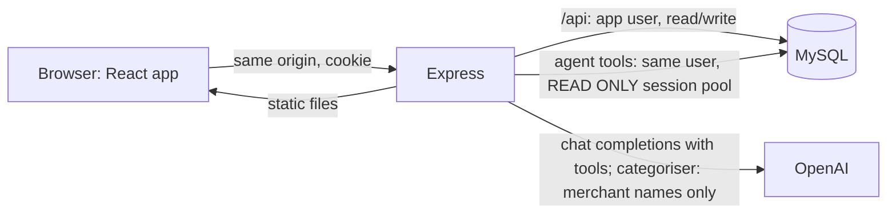
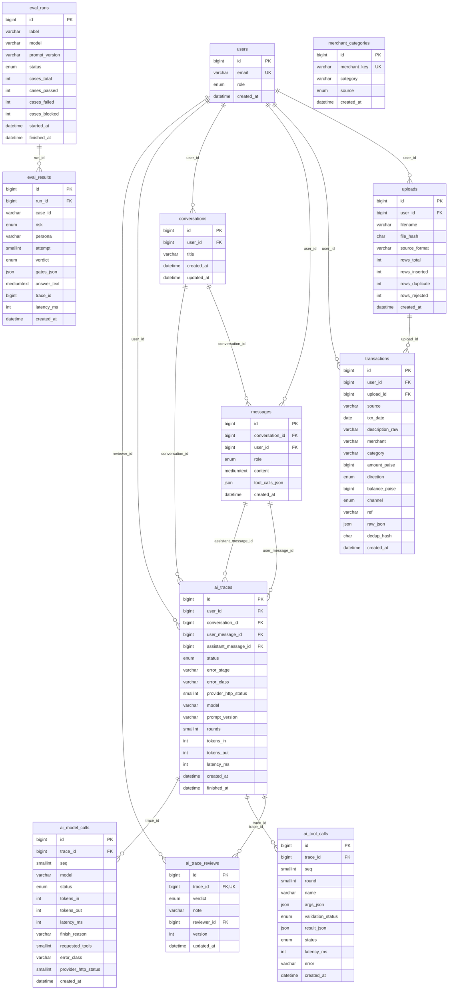

# Architecture

## Tech stack
| layer | choice | where |
|---|---|---|
| Server | Node.js 22, Express 5, ES modules | [server/src/app.js](../../server/src/app.js) |
| Database | MySQL 8 (`mysql2` driver), one idempotent schema file | [server/db/schema.sql](../../server/db/schema.sql) |
| AI | OpenAI chat completions with function calling (tools), `gpt-4.1-mini` by default | [server/src/agent/agent.js](../../server/src/agent/agent.js) |
| Client | React + Vite, Tailwind + shadcn/ui | `client/` (frontend branch) |
| Tests | Vitest + Supertest (server), Vitest + Testing Library (client) | [server/test/](../../server/test/) |
| Deploy | one Railway service + Railway MySQL | [docs/deploy/railway-runbook.md](../deploy/railway-runbook.md) |

## System

- One process serves the built client and the API ([server/src/http/static-client.js](../../server/src/http/static-client.js)).
- One database user, two pools: the app pool for normal routes, and a pool whose sessions are `READ ONLY` for the AI's tools ([server/src/db.js](../../server/src/db.js), [server/src/index.js](../../server/src/index.js)).
- OpenAI sees questions, earlier turns of the same conversation and tool results. The categoriser sends only cleaned merchant names, never amounts, references or people's names.

## Data model (generated)
Generated by `npm run artifacts:build` from `information_schema` after applying [server/db/schema.sql](../../server/db/schema.sql). Full detail: [schema.json](schema.json).

<!-- generated:er -->
_Generated 2026-11-25 00:03 IST by `npm run artifacts:build`: 12 tables, 15 foreign keys._

<!-- /generated:er -->

## One chat message, end to end (verified)
Each step names a file and a symbol; a test checks every one exists ([server/test/artifacts.test.js](../../server/test/artifacts.test.js)). Data: [request-flow.json](request-flow.json).

<!-- generated:flow -->
_Checked 2026-11-25 00:03 IST: 13/13 steps found in code. Tables read: conversations, messages, transactions. Written: messages, conversations, ai_traces, ai_model_calls, ai_tool_calls._

| # | step | file | symbol | found |
|---|---|---|---|---|
| 1 | User presses Send; the chat thread calls send() | `client/src/features/chat/ChatThread.jsx` | `async function send(` | yes |
| 2 | API client posts the text | `client/src/api/endpoints.js` | `export const sendMessage` | yes |
| 3 | Express route: POST /api/conversations/:id/messages (auth, rate limit, ownership check) | `server/src/chat/routes.js` | `router.post('/conversations/:id/messages'` | yes |
| 4 | The trace row is written IN_PROGRESS before any AI call (fail closed) | `server/src/agent/recorder.js` | `async startTrace(` | yes |
| 5 | Tools are bound to the session user and the read-only pool | `server/src/agent/tools.js` | `export function createTools(` | yes |
| 6 | Agent loop: up to 5 tool rounds | `server/src/agent/agent.js` | `async reply(` | yes |
| 7 | OpenAI chat completion with the tool definitions | `server/src/agent/agent.js` | `openai.chat.completions.create(` | yes |
| 8 | A tool runs, e.g. spend_summary | `server/src/agent/tools.js` | `async spend_summary(` | yes |
| 9 | Query builder adds user_id = ? and the spend rule; reads transactions | `server/src/agent/query.js` | `const clauses = ['user_id = ?'];` | yes |
| 10 | Each model and tool call is recorded (ai_model_calls, ai_tool_calls) | `server/src/agent/recorder.js` | `export function traceHooks(` | yes |
| 11 | Answer and finished trace commit in one transaction (messages, ai_traces) | `server/src/chat/routes.js` | `await conn.beginTransaction();` | yes |
| 12 | Response: user_message and assistant_message, never tool calls | `server/src/chat/routes.js` | `res.status(201).json({ user_message` | yes |
| 13 | The client renders the answer as safe markdown (no innerHTML) | `client/src/features/chat/Markdown.jsx` | `never innerHTML` | yes |
<!-- /generated:flow -->
